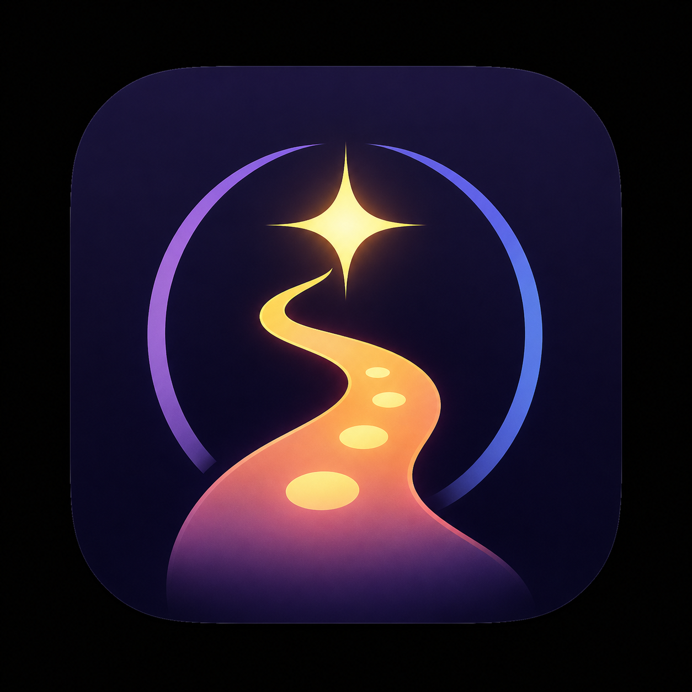
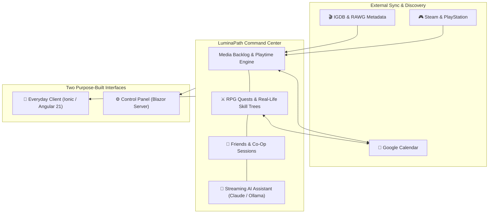

<div align="center">
  

  <h1>LuminaPath</h1>

  <p>
    
    <br />
    <strong>A personal learning project and self-hosted command center for your media and real-life quests.</strong>
  </p>

  <p>
    <strong>Your games, movies, series, and anime library, backlog planner, playtime tracker, social hub, and RPG-style quest board in one place.</strong>
  </p>

  <p>
    <a href="https://github.com/dominictosku/LuminaPath/stargazers">
      
    </a>
    <a href="https://github.com/dominictosku/LuminaPath/network/members">
      
    </a>
    <a href="https://github.com/dominictosku/LuminaPath/issues">
      
    </a>
    <a href="https://github.com/dominictosku/LuminaPath/actions/workflows/ci.yml">
      
    </a>
    <a href="https://github.com/dominictosku/LuminaPath/actions/workflows/publish.yml">
      
    </a>
  </p>

  <p>
    
    
    
    
    
  </p>

  <p>
    <a href="#overview">Overview</a>
    <span> | </span>
    <a href="#features">Features</a>
    <span> | </span>
    <a href="#quick-start">Quick Start</a>
    <span> | </span>
    <a href="#documentation">Documentation</a>
    <span> | </span>
    <a href="#tech-stack">Tech Stack</a>
    <span> | </span>
    <a href="#development">Development</a>
    <span> | </span>
    <a href="#license">License</a>
  </p>
</div>

---

## Overview

> **One sovereign cockpit for your entertainment backlog, playtime history, social gaming, and real-life RPG progression.**

LuminaPath unifies your fragmented digital hobbies and channels them into real-world momentum. Instead of juggling separate services for game backlogs, anime watchlists, movie diaries, habit trackers, and gaming calendars, LuminaPath brings everything together into a single privacy-first, self-hosted command center.



### What Makes LuminaPath Special

<table>
  <tr>
    <td width="50%" valign="top">
      <h3>🎮 Cross-Media Universe</h3>
      <p>Seamlessly organize games, movies, series, and anime. Track release dates, custom cover art, personal ratings, and detailed backlog status across all your platforms in one unified view.</p>
    </td>
    <td width="50%" valign="top">
      <h3>⏱️ Unified Playtime Tracking</h3>
      <p>Log manual play sessions or sync playtime and trophies directly from Steam and PlayStation Network. Gain true insights into your gaming habits with estimated vs. actual playtime analytics.</p>
    </td>
  </tr>
  <tr>
    <td width="50%" valign="top">
      <h3>⚔️ RPG-Style Life Quests</h3>
      <p>Turn real-life goals and habits into an interactive RPG. Structure your ambitions into Main Quests, Side Quests, Factions, and branching Skill Trees with XP and milestone tracking.</p>
    </td>
    <td width="50%" valign="top">
      <h3>🧠 Context-Aware AI Companion</h3>
      <p>A streaming AI assistant (Claude, Ollama, or vLLM) embedded directly in your app. It has secure, user-scoped read access to your library and can draft quests with confirm-first safety.</p>
    </td>
  </tr>
  <tr>
    <td width="50%" valign="top">
      <h3>🤝 Self-Hosted Social Hub</h3>
      <p>Add friends, coordinate co-op gaming sessions, and chat directly without relying on big-tech platforms or telemetry. Your social graph stays strictly on your server.</p>
    </td>
    <td width="50%" valign="top">
      <h3>🛡️ Sovereign Data & Storage Freedom</h3>
      <p>Deploy in seconds with Docker. Choose between local disk storage, AWS S3 / MinIO, or private Google Drive, with built-in zero-downtime migration and integrity verification tools.</p>
    </td>
  </tr>
</table>

### Dual-Interface Architecture

LuminaPath pairs a high-performance ASP.NET Core & PostgreSQL backend with two purpose-built frontends:

- **Everyday Mobile & Web App (`:4200`)**: Engineered with Angular 21 & Ionic for a fluid, responsive experience across phones, tablets, and desktop browsers. Features touch gestures, release calendars, and instant search.
- **Admin & Diagnostic Portal (`:4200/Admin`)**: Powered by Blazor Server & MudBlazor for server administrators. Provides real-time storage health audits, ghost/orphan blob reconciliation, user role management, and background job telemetry.

---

## Features

- **Multi-Media Catalog**: Comprehensive tracking for games, movies, series, and anime with genres, platforms, cover images, and release calendars.
- **Backlog & Playtime Tracking**: Personal status (Backlog, In Progress, Completed, Abandoned), ratings, playtime estimates, and automatic totals combining manual logs and third-party imports.
- **Third-Party Imports & Metadata**: Connect Steam, PlayStation Network, IGDB, and RAWG to import library titles and play records.
- **Google Calendar Sync**: Push upcoming media release dates and scheduled quests directly into a dedicated Google Calendar.
- **RPG Productivity System**: Real-life quest board with main and side quests, skill trees, levels, and faction alignment.
- **Streaming AI Assistant**: In-app AI companion with user-scoped database tools and Model Context Protocol (MCP) server support.
- **Flexible Storage Backends**: Use local disk storage out of the box, or seamlessly connect AWS S3, Cloudflare R2, MinIO, Azure Blob, or personal Google Drive with zero-downtime migration tooling.
- **Self-Hosted & Container-Ready**: Single-command startup with Docker Compose, including health checks, automated database migrations, and optional local LLM execution.

---

## Quick Start <a id="quick-docker-setup"></a>

Run LuminaPath with Docker Compose (v2.30+).

### 1. Configure Environment

Copy the example environment file:

```sh
cp .env.example .env
```

*(On Windows PowerShell: `Copy-Item .env.example .env`)*

Open `.env` and fill in the three required credentials:

```dotenv
POSTGRES_PASSWORD=your-strong-database-password
LUMINAPATH_ADMIN_EMAIL=you@example.com
LUMINAPATH_ADMIN_PASSWORD=your-strong-admin-password
```

> [!TIP]
> The admin password must be at least 10 characters long and contain uppercase, lowercase, a number, and a special character.

### 2. Start the Stack

Start all services in detached mode:

```sh
docker compose up -d
```

### 3. Open the App

- **Web / Mobile App**: <http://localhost:4200>
- **Admin & Management**: <http://localhost:4200/Admin>

Sign in using the admin email and password configured in your `.env`. Automatic database migrations run on startup, initializing your database immediately.

---

### Managing the Stack

#### Updating to the Latest Release

```sh
docker compose pull
docker compose up -d
```

To pin your deployment to a specific version, set `LUMINAPATH_VERSION=1.2.3` in `.env`.

#### Building Container Images Locally

To build and run from local source instead of pulled registry images:

```sh
docker compose -f compose.yml -f compose.dev.yml up -d --build
```

Or build individual containers directly:

```sh
# Backend API
docker build -f src/LuminaPath/Dockerfile -t luminapath-api:local .

# Angular/Ionic Frontend
docker build -f src/LuminaPath.MobileApp/Dockerfile -t luminapath-frontend:local .
```

#### Optional Compose Profiles

Enable optional add-ons using the `--profile` flag or by setting `COMPOSE_PROFILES` in `.env`:

- **Database Management (pgAdmin)**:
  ```sh
  docker compose --profile tools up -d
  ```
  Access pgAdmin at <http://localhost:5050> (`admin@example.com` / `admin`).
- **Nginx Reverse Proxy with TLS**:
  ```sh
  docker compose --profile proxy up -d
  ```
- **Local AI with vLLM (GPU)**:
  ```sh
  docker compose -f compose.yml -f compose.vllm.yml --profile nvidia up -d  # or --profile amd
  ```

---

## Documentation

Comprehensive project documentation lives in the [`docs/`](docs/index.md) folder:

| Guide | Description |
|---|---|
| **[Configuration Reference](docs/05-runbooks/configuration.md)** | Full environment variable reference, network proxies, security headers, and secrets. |
| **[Storage Providers & Migration](docs/05-runbooks/storage-providers.md)** | S3, MinIO, Google Drive, Azure Blob setup, and zero-downtime migration runbooks. |
| **[AI Assistant & MCP Guide](docs/03-features/ai-assistant.md)** | AI chat architecture, database tool calling, and MCP server configuration. |
| **[Third-Party Integrations](docs/03-features/integrations.md)** | Setup for Google Calendar sync, Steam, PSN, and IGDB/RAWG metadata. |
| **[Database Migrations](docs/05-runbooks/migrations.md)** | EF Core migration workflows and production SQL script generation. |
| **[Architecture & C4 Diagrams](docs/02-architecture/index.md)** | Container architecture, system context, API reference, and design decisions (ADRs). |
| **[Local Setup & Development](docs/05-runbooks/local-setup.md)** | Running .NET and Angular natively on your workstation. |
| **[Updating the App](docs/05-runbooks/updating-the-app.md)** | Dependency upgrade guides and version maintenance. |

To preview the documentation site locally:

```sh
pip install -r requirements-docs.txt
mkdocs serve
```

---

## Tech Stack

| Layer | Technologies |
|---|---|
| **Backend API** | .NET 10, ASP.NET Core, EF Core, ASP.NET Identity, Serilog |
| **Admin Portal** | Blazor Server, MudBlazor |
| **Client Frontend** | Angular 21, Ionic Framework, TypeScript, TailwindCSS |
| **Database & Cache** | PostgreSQL 17, Redis 7 |
| **Storage Backends** | Local Filesystem, AWS S3 / MinIO, Google Drive API, Azure Blob |
| **AI Integration** | Anthropic Claude, OpenAI-compatible APIs, vLLM, Model Context Protocol (MCP) |
| **Deployment** | Docker, Docker Compose, GitHub Actions |

---

## Development

Prerequisites for local development outside Docker:
- [.NET 10 SDK](https://dotnet.microsoft.com/)
- [Node.js 22+ & npm](https://nodejs.org/)
- Running PostgreSQL 17 and Redis instances (or use `docker compose -f compose.yml up -d db redis`)

```sh
# Run backend API & Blazor Admin
dotnet run --project src/LuminaPath/LuminaPath.csproj

# Run Angular/Ionic frontend
cd src/LuminaPath.MobileApp
npm install
npm start
```

For test execution, code style guidelines, and Android APK builds, see [CONTRIBUTING.md](CONTRIBUTING.md).

---

## License

LuminaPath source code and documentation are licensed under the **GNU Affero General Public License, version 3 only** (`AGPL-3.0-only`). See [LICENSE](LICENSE) for full terms.

Dependencies and bundled third-party libraries retain their respective licenses; see [THIRD_PARTY_NOTICES.md](THIRD_PARTY_NOTICES.md) for details.
