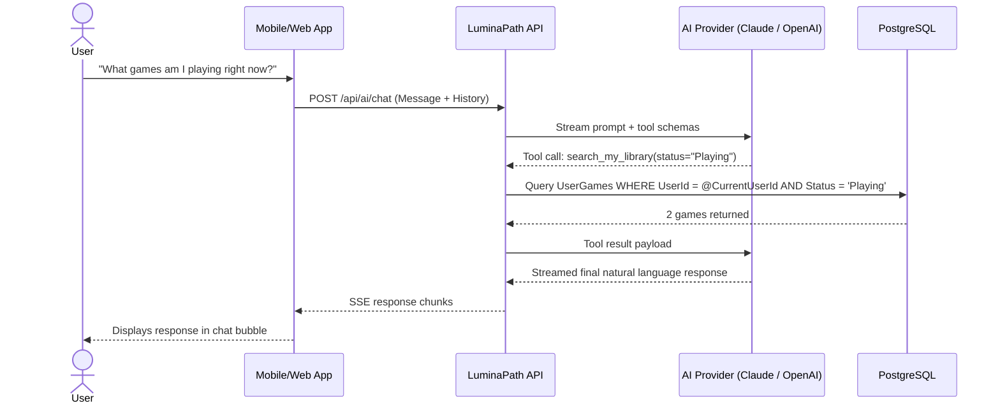

# AI Assistant

The LuminaPath AI Assistant is an interactive chat companion embedded in the Angular/Ionic web and mobile interfaces. It helps users manage their media backlog, plan game releases, track quests, and look up library statistics using natural conversation.

---

## Capabilities & Design

- **Provider Agnostic**: Connects to Anthropic (Claude 3.5 Sonnet / Claude 3 Opus) or any OpenAI-compatible API (local Ollama, LM Studio, vLLM, or OpenAI).
- **User-Scoped Security**: Built-in database tools are strictly scoped to the authenticated user's ID. The model cannot read or alter another user's data.
- **Confirm-First Writes**: For mutative actions (such as adding a quest), the agent is instructed to present the proposed details and receive explicit user confirmation before executing the tool.
- **Model Context Protocol (MCP)**: Extensible via standard MCP servers running as stdio subprocesses (e.g. web search, file tools).

---

## Built-In Database Tools

The AI assistant has access to the following native functions:

| Tool Name | Access Level | Description |
|---|---|---|
| `list_upcoming_releases` | Read | Queries upcoming release dates for games in the catalog or the user's own library. Supports month and year filters. |
| `search_my_library` | Read | Searches the authenticated user's tracked media by title fragment, status, or platform. |
| `library_summary` | Read | Returns aggregated statistics: total titles, playtime logged, backlog hours estimate, and completion counts. |
| `my_quests` | Read | Lists user quests, filterable by `open`, `completed`, or `all`. |
| `my_gaming_sessions` | Read | Retrieves upcoming scheduled co-op and gaming sessions in a given date range (default 14 days). |
| `create_quest` | Write (Confirm-First) | Adds a new quest to the user's quest board. |

---

## How Tool Calling Works



---

## Model Context Protocol (MCP) Servers

In addition to built-in database tools, the assistant can interact with external tools using the [Model Context Protocol](https://modelcontextprotocol.io/).

MCP servers are configured in `appsettings.json` or environment variables under the `Mcp:Servers` section. LuminaPath spawns configured MCP servers as subprocesses via standard input/output (stdio).

### Configuration Example

```json
{
  "Mcp": {
    "Servers": [
      {
        "Name": "brave-search",
        "Enabled": true,
        "Command": "npx",
        "Args": [ "-y", "@modelcontextprotocol/server-brave-search" ],
        "Env": {
          "BRAVE_API_KEY": ""
        }
      }
    ]
  }
}
```

To provide the API key in Docker:

```dotenv
BRAVE_API_KEY=your_brave_search_api_key_here
```

### Tool Namespacing & Safety

- MCP tools appear to the model prefixed with `mcp__<ServerName>__<ToolName>` (e.g. `mcp__brave-search__brave_web_search`) to prevent collisions with native tools.
- Servers with empty required environment variables are gracefully skipped during startup, ensuring the assistant operates normally even if optional MCP tools are unconfigured.

---

## Configuration & Tuning

Key environment variables (see the [Configuration Reference](../05-runbooks/configuration.md) for full list):

- `AiChat__Provider`: `anthropic` or `openai`.
- `AiChat__MaxToolIterations`: Default `8`. Maximum number of tool round-trips before the assistant must provide a final answer.
- `ANTHROPIC_API_KEY` / `Anthropic__Model`: Credentials and model for Anthropic (default `claude-sonnet-4-6`).
- `OPENAI_BASE_URL` / `OPENAI_MODEL`: Endpoint and model for OpenAI-compatible gateways (default `http://localhost:11434/v1` and `llama3.2`).
